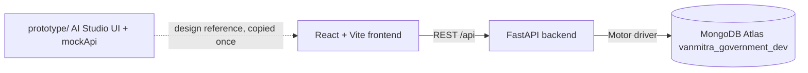
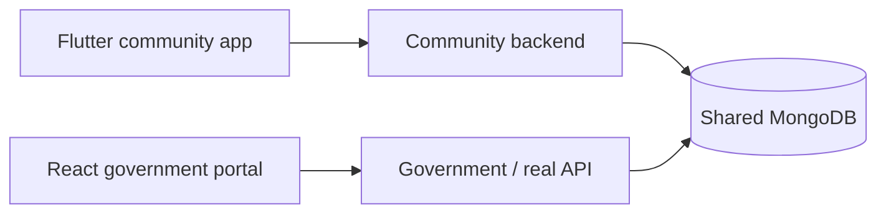

# Architecture

## Development

The browser talks only to FastAPI. MongoDB credentials exist only in the backend environment.

## Future integration

The frontend only knows `VITE_API_BASE_URL`. Replacing the dev FastAPI with the real API, and the dev database with the shared one, is a configuration change.

## Layers
- **Frontend** (`frontend/src`): pages and components render data; `services/api/*` is the only code that calls the network; `context` holds auth and theme.
- **Backend** (`backend/app`): `routers` (HTTP), `workflow.py` (state machine and role rules), `visibility.py` (who can see which claim), `security.py` (JWT, passwords), `database.py` (one Mongo client for the app lifetime), `seed.py` (demo data).
- **Workflow:** UI requests an action; backend checks role, current state, required fields; writes workflow event + audit log; updates the claim. React never sets status.
- **Visibility:** enforced in the backend for dashboard, lists, detail, timeline and audit. Out-of-scope claims return 404.
- **Documents/PDF/signatures (planned):** `DocumentStorageService` abstraction; server-side PDF from a template; `SignatureProvider` interface with a mock provider now and an approved eSign/DSC provider later. See `PDF_AND_SIGNATURES.md`.
- **Notifications (planned):** created by workflow events; frontend polls via REST. No WebSockets until required.

## Why the frontend stays independent of the database
The contract is the API (`API.md`). If the real backend implements the same endpoints and response shapes, no component changes.

## Deliberately not used
TypeScript, Redis, ChromaDB, Kafka, Kubernetes, microservices, WebSockets.
