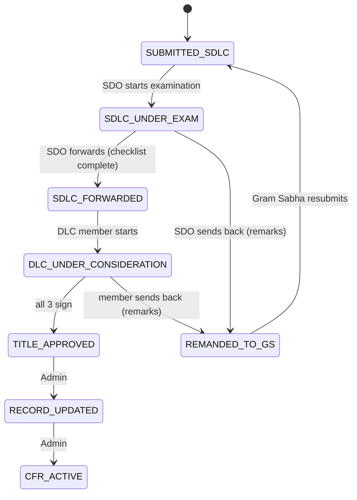

# Claim workflow (government side)

Gram Sabha work is done in the community app. A claim first appears for the SDO when it is submitted.

| From | Action | To | Roles (assumption) |
|---|---|---|---|
| SUBMITTED_SDLC | START_EXAMINATION | SDLC_UNDER_EXAM | SDO |
| SDLC_UNDER_EXAM | FORWARD | SDLC_FORWARDED | SDO |
| SDLC_UNDER_EXAM | REMAND | REMANDED_TO_GS | SDO |
| SDLC_FORWARDED | START_CONSIDERATION | DLC_UNDER_CONSIDERATION | DFO, DTWO, Collector |
| DLC_UNDER_CONSIDERATION | APPROVE (placeholder, see below) | TITLE_APPROVED | DFO, DTWO, Collector |
| DLC_UNDER_CONSIDERATION | REMAND | REMANDED_TO_GS | DFO, DTWO, Collector |
| TITLE_APPROVED | RECORD_UPDATE | RECORD_UPDATED | Admin |
| RECORD_UPDATED | ACTIVATE | CFR_ACTIVE | Admin |

**Not yet built:** the three-signature rule. Target: each of DFO/DCF, DTWO and Collector signs once per round; the third signature moves the claim to TITLE_APPROVED and generates the title. A send-back voids that round's signatures (kept in audit, never deleted). Until Phase 8 the backend has a single-step APPROVE placeholder in `workflow.py`.

Other states in the project vocabulary (not used by the government portal): DRAFT, EVIDENCE_COLLECTION, MAPPING_IN_PROGRESS, FRC_VERIFICATION, GS_READY, GS_RESOLVED, MODIFIED_REJECTED, PETITION_FILED.

All role rules live in `backend/app/workflow.py` and are development assumptions to confirm (`ASSUMPTIONS.md`).
